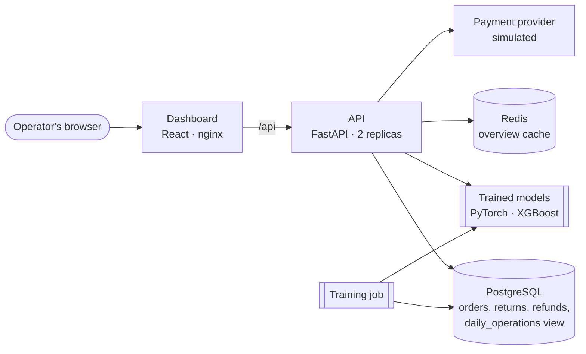

# OrderPulse

Operations platform for e-commerce support teams: track orders through fulfillment, handle returns and refunds, and prioritize the issues that matter most.


## What it does

**For operators**
- A live pipeline of orders in flight, key metrics, and 30-day trends on one screen.
- Orders move through `placed → packed → shipped → out_for_delivery → delivered` (or `cancelled`), enforced by a state machine with a full audit trail.
- Returns are accepted only for delivered orders, inside a 30-day window, and never for more units than were bought. Operators approve, receive, and refund them from a work queue.

**Reliability**
- **Exactly-once refunds**: every refund carries an `Idempotency-Key`. Retries replay the original response, concurrent duplicates are serialized, and a database constraint guarantees one refund per return. The dashboard retries network failures with the same key.
- **Safe under concurrency**: state changes lock the affected row (`SELECT … FOR UPDATE`); migrations take an advisory lock so several API instances can start at once.
- Money is integer cents, totals are computed on the server, and every error has the same JSON shape.

**Performance**
- The overview reads precomputed daily totals from a PostgreSQL materialized view, computes only today live, and is cached in Redis. Writes invalidate the cache immediately. Measured: 108 ms → 4 ms on 400,000 orders.
- If Redis fails, a circuit breaker steps around it and the API keeps serving from the database.

**Machine learning**
- **Routing**: a PyTorch text classifier reads what the customer wrote and sends each return to the right team: 17.1% → 5.3% misrouted versus trusting the customer's selected reason.
- **Prioritization**: an XGBoost model estimates each return's chance of escalating, so the queue works the riskiest first. Agents' routing corrections become future training labels.

## Architecture



The API is layered: routes validate HTTP input, services hold the business logic, the domain package holds the rules (order and return lifecycles), and models and schemas define the database tables and the API contract.

## Tech stack

| Layer | Tools |
|---|---|
| Dashboard | React 19, TypeScript, Vite, React Router, TanStack Query, Recharts |
| API | Python 3.13, FastAPI, Pydantic |
| Data | PostgreSQL 16 (materialized views), Redis 7, SQLAlchemy 2, Alembic migrations |
| Machine learning | PyTorch, XGBoost, NumPy |
| Testing & quality | pytest, Vitest, Testing Library, Ruff |
| Delivery | Docker, Docker Compose, Kubernetes (Kustomize), GitHub Actions |

## Running it

There are three ways to run OrderPulse, from quickest to most production-like. All need [Docker Desktop](https://www.docker.com/products/docker-desktop/).

**1. Everything in Docker** (no local Python or Node needed)

```bash
make stack        # build and start Postgres, Redis, the API, and the dashboard
make stack-demo   # load demo data and train the models
```
Open **http://localhost:8080**. Stop with `make stack-down`.

**2. Local development** (Python 3.11+, Node.js 20+)

```bash
make setup   # start Postgres and Redis, install dependencies, migrate, load data, train models
make api     # API with auto-reload at http://localhost:8000 (interactive docs at /docs)
make web     # dashboard with hot reload at http://localhost:5173 (second terminal)
```

**3. Kubernetes** (enable Kubernetes in Docker Desktop's settings)

```bash
make k8s-build   # build the images
make k8s-up      # deploy Postgres, Redis, 2 API replicas, and the dashboard
make k8s-demo    # run the demo-data job, then roll the API to load the new models
```
Open **http://localhost:8090**. Remove everything with `make k8s-down`.

Run `make` to list every command. To try it at scale: `make seed-large && make train && make bench`.

## API

| Method | Path | Description |
|---|---|---|
| `GET` | `/health` | Readiness: database and cache status |
| `GET` | `/health/live` | Liveness: the process is up |
| `GET` | `/api/v1/orders` | List orders. Filters: `status`, `customer_id`, `q`; paging: `limit`, `offset` |
| `POST` | `/api/v1/orders` | Place an order |
| `GET` | `/api/v1/orders/{order_number}` | Order details with line items and status history |
| `POST` | `/api/v1/orders/{order_number}/status` | Move an order to its next status |
| `POST` | `/api/v1/orders/{order_number}/returns` | Request a return for a delivered item |
| `GET` | `/api/v1/returns` | List returns. Filters: `status`, `reason`, `order_number` |
| `GET` | `/api/v1/returns/{return_number}` | Return details, including any refund |
| `POST` | `/api/v1/returns/{return_number}/status` | Approve, reject, or mark as received |
| `POST` | `/api/v1/returns/{return_number}/refund` | Issue the refund (requires `Idempotency-Key`) |
| `GET` | `/api/v1/customers` | Search customers by name or email |
| `GET` | `/api/v1/customers/{id}` | Customer details |
| `POST` | `/api/v1/returns/{return_number}/team` | Reassign a return to another team |
| `GET` | `/api/v1/stats/overview` | Pipeline, metrics, and trends for the dashboard |
| `GET` | `/api/v1/ml/models` | Loaded models, training date, and held-out evaluation metrics |

## Screenshots

| Returns queue | Order detail |
|---|---|
|  |  |

## Project structure

```
frontend/
  src/
    pages/      Overview, orders, order detail, returns queue
    components/ Pipeline, status pills, chart, layout, shared states
    api/        Typed API client and data-fetching hooks
    lib/        Formatting and the refund retry logic
backend/
  app/
    api/        HTTP routes (thin: validate input, call a service, return output)
    services/   Business logic
    domain/     Core rules: order and return lifecycles, return routing
    models/     Database tables (SQLAlchemy)
    schemas/    Request and response contracts (Pydantic)
    core/       Settings, error handling, idempotency
    integrations/  External services (payment provider)
    ml/         Routing and priority models, training, evaluation
    db/         Database engine and sessions
    seed.py     Demo data generator
  alembic/      Database migrations
  tests/        API, concurrency, caching, and state-machine tests
infra/
  k8s/          Kubernetes manifests (Kustomize) and the demo-data job
  postgres/     Database initialization for Docker Compose
```

## Testing

```bash
make test      # backend
make web-test  # frontend type-check and tests
```

Backend tests run against a dedicated `orderpulse_test` database built from the real migrations, and cover order and return lifecycles, validation, error formats, idempotent retries, payment-provider failures, and concurrent updates.

## Machine learning

Both models train on closed returns, whose outcomes are known: the team that actually handled each one, and whether the customer escalated. `make train` uses a **time-based split**, learning from the oldest 80% and testing on the newest 20%, the way the models are used in production. Each model is compared against the simplest reasonable alternative.

**Return routing (PyTorch).** Customers often pick the wrong reason from the dropdown: a box crushed in shipping gets reported as "defective" and lands with the wrong team. The model is a compact fastText-style classifier: token and word-pair embeddings are averaged, then combined with the selected reason and passed through a linear layer. Below 60% confidence it defers to the dropdown.

**Prioritization (XGBoost).** Gradient-boosted trees estimate each return's chance of escalating from what's known at request time: refund and order size, membership, the customer's return history, the reason, and wording that signals frustration. Precision@20 asks: of the 20 returns the model would put at the top of the queue, how many actually escalated?

Results on the 400,000-order dataset (39,744 training and 9,936 test returns):

| Routing | Misrouted |
|---|---|
| By the customer's selected reason | 17.1% |
| By the model, with fallback below 60% confidence | 5.3% |

| Prioritization | Precision@20 | AUC |
|---|---|---|
| Random order (= escalation rate) | 0.15 | 0.50 |
| Largest refund first | 0.55 | 0.68 |
| XGBoost model | 0.90 | 0.75 |

Precision@20 looks at only 20 returns, so it moves by 0.05 whenever one return changes places (it ranged from 0.80 to 0.90 across machines). AUC, which uses every test return, is the steadier measure.

The demo data is synthetic, but built to be honest: some customer messages are vague or ambiguous, and a small share of historical labels are wrong, so neither model can score perfectly. If no trained model is present, or one fails to load, the API falls back to rule-based routing.

## Deployment

The Kubernetes setup in `infra/k8s` runs the API as two replicas with a rolling-update strategy that never drops below full capacity:

- **Health checks are split on purpose.** Readiness (`/health`) checks the database, so a pod that can't reach it stops receiving traffic. Liveness (`/health/live`) checks only that the process answers, so a database outage doesn't trigger a pointless restart loop.
- **Migrations run in an init container** before each API pod starts, serialized by a Postgres advisory lock.
- **Configuration lives outside the image** in a ConfigMap and a Secret, and containers run as a non-root user.
- **Training runs as a one-off Job** that writes the models to a shared volume; restarting the API rolls out the new models with no downtime.

CI builds both images and validates the manifests against the Kubernetes schemas on every push. Local manifests use demo credentials and in-cluster Postgres; a production setup would use a managed database and a secret manager.

## Design notes

**How the overview stays fast as data grows.** The dashboard's headline numbers cover the last 30 days. Recomputing them from raw orders on every request gets slower as history grows, so the work is split:

1. *Finished days* come from `daily_operations`, a materialized view holding one row of totals per day. The API refreshes it every 5 minutes with `REFRESH MATERIALIZED VIEW CONCURRENTLY`, so readers are never blocked, and a Postgres advisory lock ensures only one API process refreshes at a time.
2. *Today* is always computed live with indexed range queries, so the numbers operators act on are never stale.
3. *The finished response* is cached in Redis for 30 seconds. Any write that changes the numbers (an order status change, a return, a refund) deletes the cached copy, so operators see their own changes immediately.
4. *Redis is optional at runtime*: on any Redis error the cache steps aside for 15 seconds (a simple circuit breaker) and requests are served from the database.

A test asserts that the fast path returns exactly the same numbers as a full live aggregation.

Measured with `make bench` on a MacBook Pro (Apple silicon), with PostgreSQL and Redis in Docker, 400,000 orders, 30 runs each:

| Strategy | Median | p95 | Speedup |
|---|---|---|---|
| Live aggregation over raw tables | 108.6 ms | 114.1 ms | 1x |
| Materialized view + live today | 18.4 ms | 22.5 ms | 6x |
| Full HTTP request, cache miss | 26.6 ms | 33.0 ms | 4x |
| Full HTTP request, Redis cache hit | 4.3 ms | 5.3 ms | 25x |

**Why refunds can't be paid twice.** Two independent safeguards:

1. *Idempotency keys* handle retries of the same request. The key is claimed with an atomic `INSERT … ON CONFLICT DO NOTHING`, and the operation and its stored response commit in the same transaction. A concurrent duplicate blocks on the key until the first request commits, then replays its response. A request fingerprint rejects a key reused for a different request.
2. *Row locks and a unique constraint* handle different requests for the same return: the return row is locked (`SELECT … FOR UPDATE`), its status is checked, and `UNIQUE(refunds.return_id)` makes a second refund impossible at the database level.

The idempotency key is also forwarded to the payment provider, so the provider can de-duplicate on its side too.
