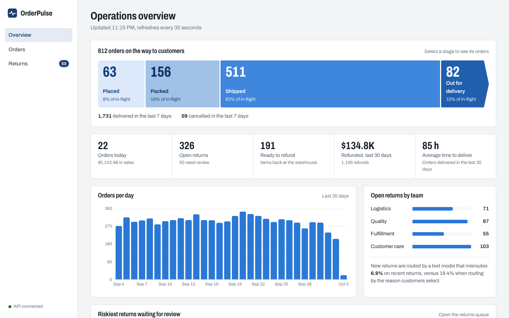
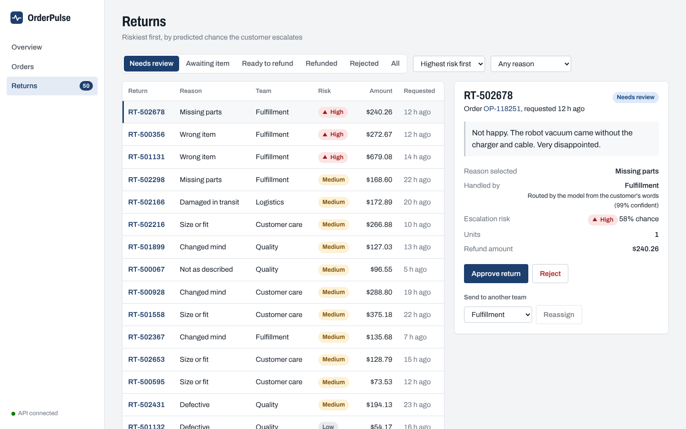
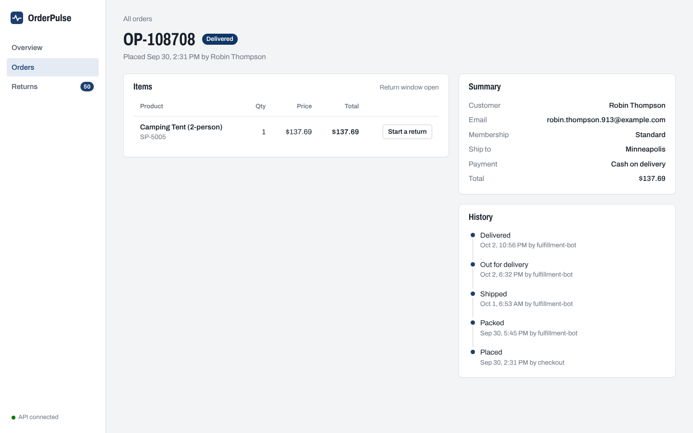

# OrderPulse

Operations platform for e-commerce support teams: track orders through fulfillment, handle returns and refunds, and prioritize the issues that matter most.




## Features

- **Order lifecycle API**: orders move through `placed → packed → shipped → out_for_delivery → delivered` (or `cancelled`), enforced by an explicit state machine. Invalid moves are rejected with `409 Conflict`.
- **Returns with eligibility rules**: returns are accepted only for delivered orders, inside a 30-day window, and never for more units than were bought. Each return is routed to the team that handles it (logistics, quality, fulfillment, or customer care).
- **Exactly-once refunds**: refunds require an `Idempotency-Key` header. Retries replay the original response instead of paying again, concurrent duplicates are serialized, and a database constraint guarantees one refund per return. Payment-provider failures roll back cleanly so the same key can be retried.
- **Full audit trail**: every status change is recorded with who made it, when, and why.
- **Safe under concurrency**: status changes lock the order row (`SELECT … FOR UPDATE`), so simultaneous updates apply exactly once.
- **Server-side money math**: totals are computed from line items in integer cents. Clients can't set them.
- **Consistent errors**: every failure returns `{"error": {"code", "message"}}`.
- **ML return routing**: a PyTorch text classifier reads what the customer wrote and routes each return to the right team, falling back to the customer's selected reason when it isn't confident. Agents can reassign a return, and their corrections become future training data.
- **ML prioritization**: an XGBoost model scores each new return's chance of escalating (a complaint or chargeback), so the review queue can work the riskiest returns first.
- **Fast at scale**: the dashboard overview reads precomputed daily totals from a PostgreSQL materialized view (refreshed concurrently in the background) and computes only today live, behind a Redis cache that writes invalidate immediately. If Redis goes down, the API keeps serving from the database.
- **Response timing**: every response carries an `X-Response-Time-Ms` header, and the overview reports `X-Cache: HIT` or `MISS`.
- **Operations dashboard**: a React console with a live order pipeline, key metrics, a first-in-first-out returns queue, and order detail pages where operators move orders forward, start returns, and issue refunds. Refunds retry network failures with the same idempotency key.
- **Realistic demo data**: a seeded generator simulates thousands of orders with true-to-life fulfillment timelines.

## Tech stack

| Layer | Tools |
|---|---|
| Dashboard | React 19, TypeScript, Vite, React Router, TanStack Query, Recharts |
| API | Python 3.13, FastAPI, Pydantic |
| Data | PostgreSQL 16 (materialized views), Redis 7, SQLAlchemy 2, Alembic migrations |
| Machine learning | PyTorch, XGBoost, NumPy |
| Testing & quality | pytest, Vitest, Testing Library, Ruff |
| Infrastructure | Docker Compose, GitHub Actions |

## Getting started

Requirements: Docker Desktop, Python 3.11+, Node.js 20+, and `make`.

```bash
make setup   # start services, install dependencies, migrate, load demo data, train models
make api     # API at http://localhost:8000 (interactive docs at /docs)
make web     # dashboard at http://localhost:5173 (in a second terminal)
```

Run `make` to see all commands, including `make test` and `make lint`.

To try it at scale, load 400,000 orders, retrain, and measure the overview:

```bash
make seed-large   # about a minute
make train        # about 20 seconds
make bench
```

## API

| Method | Path | Description |
|---|---|---|
| `GET` | `/health` | Service and database health |
| `GET` | `/api/v1/orders` | List orders. Filters: `status`, `customer_id`, `q`; paging: `limit`, `offset` |
| `POST` | `/api/v1/orders` | Place an order |
| `GET` | `/api/v1/orders/{order_number}` | Order details with line items and status history |
| `POST` | `/api/v1/orders/{order_number}/status` | Move an order to its next status |
| `POST` | `/api/v1/orders/{order_number}/returns` | Request a return for a delivered item |
| `GET` | `/api/v1/returns` | List returns. Filters: `status`, `reason`, `order_number` |
| `GET` | `/api/v1/returns/{return_number}` | Return details, including any refund |
| `POST` | `/api/v1/returns/{return_number}/status` | Approve, reject, or mark as received |
| `POST` | `/api/v1/returns/{return_number}/refund` | Issue the refund (requires `Idempotency-Key`) |
| `GET` | `/api/v1/customers` | Search customers by name or email |
| `GET` | `/api/v1/customers/{id}` | Customer details |
| `POST` | `/api/v1/returns/{return_number}/team` | Reassign a return to another team |
| `GET` | `/api/v1/stats/overview` | Pipeline, metrics, and trends for the dashboard |
| `GET` | `/api/v1/ml/models` | Loaded models, training date, and held-out evaluation metrics |

## Screenshots

| Returns queue | Order detail |
|---|---|
|  |  |

## Project structure

```
frontend/
  src/
    pages/      Overview, orders, order detail, returns queue
    components/ Pipeline, status pills, chart, layout, shared states
    api/        Typed API client and data-fetching hooks
    lib/        Formatting and the refund retry logic
backend/
  app/
    api/        HTTP routes (thin: validate input, call a service, return output)
    services/   Business logic
    domain/     Core rules: order and return lifecycles, return routing
    models/     Database tables (SQLAlchemy)
    schemas/    Request and response contracts (Pydantic)
    core/       Settings, error handling, idempotency
    integrations/  External services (payment provider)
    ml/         Routing and priority models, training, evaluation
    db/         Database engine and sessions
    seed.py     Demo data generator
  alembic/      Database migrations
  tests/        API, concurrency, caching, and state-machine tests
infra/          Database initialization
```

## Testing

```bash
make test      # backend
make web-test  # frontend type-check and tests
```

Backend tests run against a dedicated `orderpulse_test` database built from the real migrations, and cover order and return lifecycles, validation, error formats, idempotent retries, payment-provider failures, and concurrent updates.

## Machine learning

Both models train on closed returns, whose outcomes are known: the team that actually handled each one, and whether the customer escalated. `make train` uses a **time-based split**, learning from the oldest 80% and testing on the newest 20%, the way the models are used in production. Each model is compared against the simplest reasonable alternative.

**Return routing (PyTorch).** Customers often pick the wrong reason from the dropdown: a box crushed in shipping gets reported as "defective" and lands with the wrong team. The model is a compact fastText-style classifier: token and word-pair embeddings are averaged, then combined with the selected reason and passed through a linear layer. Below 60% confidence it defers to the dropdown.

**Prioritization (XGBoost).** Gradient-boosted trees estimate each return's chance of escalating from what's known at request time: refund and order size, membership, the customer's return history, the reason, and wording that signals frustration. Precision@20 asks: of the 20 returns the model would put at the top of the queue, how many actually escalated?

Results on the 400,000-order dataset (39,744 training and 9,936 test returns):

| Routing | Misrouted |
|---|---|
| By the customer's selected reason | 17.1% |
| By the model, with fallback below 60% confidence | 5.3% |

| Prioritization | Precision@20 | AUC |
|---|---|---|
| Random order (= escalation rate) | 0.15 | 0.50 |
| Largest refund first | 0.55 | 0.68 |
| XGBoost model | 0.80 | 0.75 |

The demo data is synthetic, but built to be honest: some customer messages are vague or ambiguous, and a small share of historical labels are wrong, so neither model can score perfectly. If no trained model is present, or one fails to load, the API falls back to rule-based routing.

## Design notes

**How the overview stays fast as data grows.** The dashboard's headline numbers cover the last 30 days. Recomputing them from raw orders on every request gets slower as history grows, so the work is split:

1. *Finished days* come from `daily_operations`, a materialized view holding one row of totals per day. The API refreshes it every 5 minutes with `REFRESH MATERIALIZED VIEW CONCURRENTLY`, so readers are never blocked, and a Postgres advisory lock ensures only one API process refreshes at a time.
2. *Today* is always computed live with indexed range queries, so the numbers operators act on are never stale.
3. *The finished response* is cached in Redis for 30 seconds. Any write that changes the numbers (an order status change, a return, a refund) deletes the cached copy, so operators see their own changes immediately.
4. *Redis is optional at runtime*: on any Redis error the cache steps aside for 15 seconds (a simple circuit breaker) and requests are served from the database.

A test asserts that the fast path returns exactly the same numbers as a full live aggregation.

Measured with `make bench` on a MacBook Pro (Apple silicon), with PostgreSQL and Redis in Docker, 400,000 orders, 30 runs each:

| Strategy | Median | p95 | Speedup |
|---|---|---|---|
| Live aggregation over raw tables | 108.6 ms | 114.1 ms | 1x |
| Materialized view + live today | 18.4 ms | 22.5 ms | 6x |
| Full HTTP request, cache miss | 26.6 ms | 33.0 ms | 4x |
| Full HTTP request, Redis cache hit | 4.3 ms | 5.3 ms | 25x |

**Why refunds can't be paid twice.** Two independent safeguards:

1. *Idempotency keys* handle retries of the same request. The key is claimed with an atomic `INSERT … ON CONFLICT DO NOTHING`, and the operation and its stored response commit in the same transaction. A concurrent duplicate blocks on the key until the first request commits, then replays its response. A request fingerprint rejects a key reused for a different request.
2. *Row locks and a unique constraint* handle different requests for the same return: the return row is locked (`SELECT … FOR UPDATE`), its status is checked, and `UNIQUE(refunds.return_id)` makes a second refund impossible at the database level.

The idempotency key is also forwarded to the payment provider, so the provider can de-duplicate on its side too.
